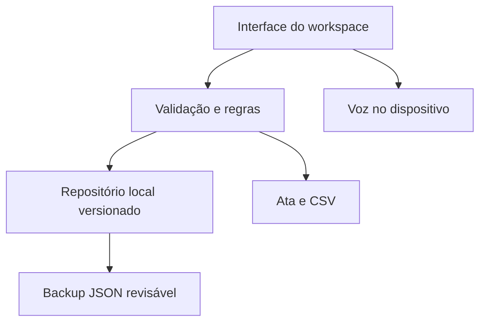

# Arquitetura — Nexo Workspace

## Problema e escopo

Após uma reunião, notas soltas não garantem que cada entrega tenha responsável, prazo e acompanhamento. O Nexo transforma o registro revisado em uma ata e um plano de ação. A versão atual é local, gratuita e adequada para uso individual/demonstração/pilotos. Ela não representa um SaaS multiempresa em produção.

## Componentes

A UI cuida de eventos e rascunhos. O domínio é independente do DOM e da persistência. O repositório recebe o armazenamento, o relógio e uma função de bloqueio, permitindo testes de falhas sem usar serviços reais. Os módulos de voz anteriores continuam separados do domínio corporativo.

O planejador de estudo é uma função HTTP independente e opcional. Registros do workspace não passam por ela. A rota antiga de transcrição paga é uma barreira HTTP 410, mantida para clientes antigos.

## Modelo versionado

Um envelope `version: 1` contém `revision`, `updatedAt` e `records`. Cada registro guarda ID, tipo, título, projeto, data, participantes, notas, decisões, ações, marca de arquivo/demonstração e datas de criação/atualização. Ações possuem ID, título, responsável, prazo, prioridade e status.

A chave local é `nexo-workspace:v1`. Dados são normalizados por lista explícita de propriedades; propriedades extras não se tornam configuração nem código. Não há HTML dinâmico vindo de notas: conteúdo é colocado em `textContent`/`value`.

## Escritas e conflitos

1. O usuário confirma uma ação de salvar.
2. Com Web Locks disponível, a escrita entra em um bloqueio por workspace na origem.
3. O repositório relê e valida o envelope persistido.
4. Se a revisão difere da revisão conhecida, a escrita é recusada; o rascunho não é aplicado sobre dados de outra aba.
5. O novo envelope é validado e serializado antes de um único `localStorage.setItem`.
6. Apenas após sucesso o estado em memória avança. Falha de quota preserva a última versão confirmada.

Sem Web Locks, a checagem de revisão detecta alterações já concluídas, mas não garante exclusão de uma corrida exatamente simultânea entre abas/processos. Para colaboração real, são necessárias transações no banco e controle de versão no servidor.

Eventos de outra aba atualizam a interface apenas se não existe rascunho local. Havendo rascunho, a UI orienta preservar o conteúdo e recarregar. Transcrições que chegam durante um salvamento permanecem como novas alterações não salvas.

## Extração com revisão humana

A extração é determinística, não generativa. Só reconhece linhas iniciadas por `Decisão:` e `Ação:`. Responsável e prazo são lidos de campos explícitos separados por `|`. Prazos ambíguos ficam em branco com aviso. A prévia só é aplicada após confirmação do usuário; notas alteradas após a prévia exigem nova extração. Itens repetidos não apagam o status já editado de uma ação.

## Backup e exportações

Importação tem limite de 2 MB e validação de versão, campos, datas, quantidade e unicidade. Mesclagem só adiciona IDs novos. Essa escolha evita substituir uma edição local por um backup antigo. Para restauração integral, use um workspace vazio; não há uma operação destrutiva automática de substituir tudo.

Atas são Markdown com o conteúdo revisado, sem promessa de resumo inteligente. CSV usa separador `;`, BOM UTF-8, escape de aspas e proteção para prefixos comuns de fórmulas em planilhas. A proteção não transforma CSV em um formato de documento executável confiável; o consumidor ainda deve tratar arquivos importados conforme sua política.

## Limites de segurança e privacidade

- Não há autenticação, RBAC, separação de tenants ou criptografia dos registros no aplicativo.
- Quem acessa o mesmo perfil do navegador pode ler os dados locais. Uma falha de script na origem também poderia acessá-los.
- O áudio local não é enviado para inferência remota. Downloads de biblioteca/modelo exigem internet e contato com os CDNs; o reconhecimento nativo tem suas próprias políticas.
- Não há telemetria de negócio ou gravação das reuniões em disco no servidor.
- A CSP mantém scripts locais e a origem fixada do runtime, com suporte a WASM. Não exige `unsafe-inline` para scripts ou estilos.
- Dados fictícios são identificados e participam dos indicadores apenas como exemplos visíveis.

## Próxima etapa para uma implantação de equipe

**Ainda não implementada:** substituir o adaptador local por API autenticada e banco transacional. Entidades previstas: organizações, membros, registros, decisões, ações e eventos de auditoria. Cada operação deverá validar organização e permissão no servidor; IDs do cliente não constituem autorização.

Antes de receber dados corporativos sensíveis: implementar autenticação/SSO apropriado, papéis, isolamento entre organizações, autorização nos testes, política de retenção, exclusão/restauração, backups de servidor e revisão de segurança. A versão atual não simula esses controles na UI.
